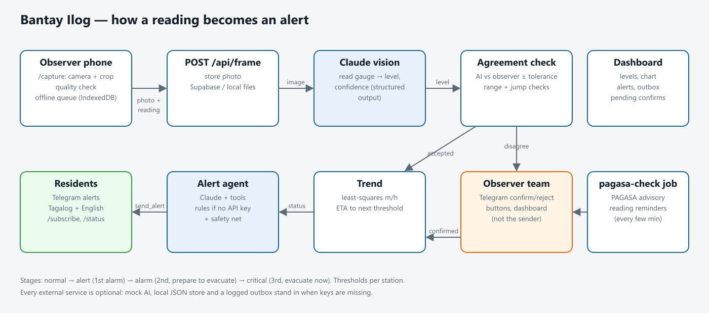

# Bantay Ilog — River Watch

Community river-gauge monitoring for flood early warning. Volunteers photograph the river's staff gauge from
their phones. Claude reads the water level from the photo, the reading is checked against the observer's own,
the system tracks how fast the river is rising, and an alert agent warns residents on Telegram, in Tagalog and
English, before the river reaches the evacuation level.



## How a reading flows

1. **Capture** (`/capture`) — the phone camera shows a guide box; the photo is cropped to the gauge, checked for
   darkness, blur, glare and missing gauge colours (`lib/client/colorCheck.ts`), and sent with the observer's own
   reading. With no signal it is kept in IndexedDB and re-sent later (`lib/client/offlineQueue.ts`).
2. **Read** (`POST /api/frame`) — the photo is stored and Claude reads the level with vision + structured output
   (`lib/server/readGauge.ts`, prompt in `prompts/read-gauge.md`).
3. **Agree** (`lib/server/agree.ts`) — accepted automatically only if AI and observer agree within the station
   tolerance (or the AI alone is very confident), the value is on the gauge, and the change since the last
   reading is physically plausible. Anything else goes to the observer team on Telegram with
   one-tap confirm/reject buttons, or to the dashboard. A reading can't be confirmed by the person who sent it.
4. **Trend** (`lib/server/trend.ts`) — least-squares rate of rise over the last 2 hours and projected time to the
   next threshold.
5. **Alert** (`lib/server/alertAgent.ts`) — on a stage change, an elevated stage, a fast rise, or an all-clear,
   a Claude tool-use agent (`lib/server/tools.ts`, prompt in `prompts/alert-agent.md`) looks at the status,
   history and PAGASA advisory and decides whether to message residents. Guardrails in the tools: the alert level
   must equal the measured stage, and the same stage can't be re-sent within 15–120 min. A deterministic
   **safety net** sends the stage alert itself if the river rose into a higher stage and the agent didn't.
6. **Reminders** (`jobs/pagasa-check`) — at alert/alarm/critical stage the team is reminded to take readings
   every 60/30/15 minutes; the job also checks the PAGASA rainfall advisory.

Flood stages follow the 1st/2nd/3rd alarm convention: **alert** (be alert), **alarm** (prepare to evacuate),
**critical** (evacuate now). Thresholds are per station (`/setup`).

## Run it

```bash
npm install
npm run dev          # http://localhost:3000
```

Everything works without any accounts. Each external service is optional and falls back to a local stand-in:

| Service | Configure | Without it |
|---|---|---|
| Claude (gauge reading + alert agent) | `ANTHROPIC_API_KEY` | **Mock mode**: only the demo station's synthetic photos are "read"; real photos are stored and sent for human confirmation. Alerts use the built-in rules. |
| Supabase (database + photo storage) | `SUPABASE_URL`, `SUPABASE_SERVICE_ROLE_KEY`; run `supabase/schema.sql`; create the `gauge-photos` bucket | JSON file + photos under `DATA_DIR` (default `.data/`) |
| Telegram | `TELEGRAM_BOT_TOKEN`, `TELEGRAM_WEBHOOK_SECRET`, then `setWebhook` (see `/setup`) | Messages are printed to the server log and shown in the dashboard outbox |
| PAGASA advisory | `PAGASA_ADVISORY_URL` | Advisory step skipped; set one manually with `npm run job:pagasa -- --set orange "text"` |

Copy `.env.example` to `.env.local` to configure. The Claude model defaults to `claude-opus-5-5`
(`CLAUDE_MODEL` to change). Requests opt in to server-side refusal fallback (`fallbacks: "default"`).

Then open **`/demo`** and press *Run demo*: eight synthetic gauge photos of a rising river go through the real
pipeline, including one disagreement that a team leader confirms, and you can see every alert and message.

### Other commands

```bash
npm test                    # unit tests (agreement, trend, tools, alert rules, pipeline, reminders)
npm run typecheck
npm run build && npm start  # production server
npm run job:pagasa          # one advisory + reminder pass;  -- --loop 5  to run every 5 min
npm run test:photos         # AI accuracy on your own labelled photos (see test-photos/README.md)
npm run samples             # regenerate demo gauge images and the alarm sound
```

Run the job on a schedule in production (cron, a container with `--loop 5`, etc.); reminders depend on it.

### Docker

```bash
docker build -t bantay-ilog .
docker run -p 3000:3000 --env-file .env.local -v bantay-data:/data bantay-ilog
```

## Telegram commands

Residents: `/subscribe <station>`, `/stop`, `/status`. Deep link: `https://t.me/<bot>?start=<station>`.
Observer team (chat IDs listed on the station in `/setup`): receive confirmation requests with buttons and
reading reminders; can send `/reading <station> <metres>` (still needs a second person to confirm).
Anyone: `/myid`, `/stations`, `/help`.

## Security notes

- Set `ADMIN_TOKEN` in any deployment. Without it, editing stations and confirming/rejecting readings from the
  web is open to anyone who can reach the server (fine on a laptop, not on the internet).
- Set `TELEGRAM_WEBHOOK_SECRET` so only Telegram can call `/api/telegram`.
- `/api/frame` and `/api/readings` (POST) are open by design so volunteers don't need accounts; put the app behind
  your platform's rate limiting.
- The Supabase schema enables row-level security with no public policies; only the server's service-role key can
  read or write.

## Project layout

```
app/            pages (capture, dashboard, demo, setup) and API routes
lib/            shared domain code (schemas, flood levels, gauge image generator)
lib/server/     pipeline, AI, storage, notifications, alert agent, reminders
lib/client/     camera, crop, photo quality check, offline queue
jobs/           PAGASA advisory + reminder job
prompts/        system prompts for the gauge reader and alert agent
supabase/       database schema
tests/          vitest unit tests
docs/           architecture diagram, field feedback log
```

## License

MIT — see [LICENSE](LICENSE).
